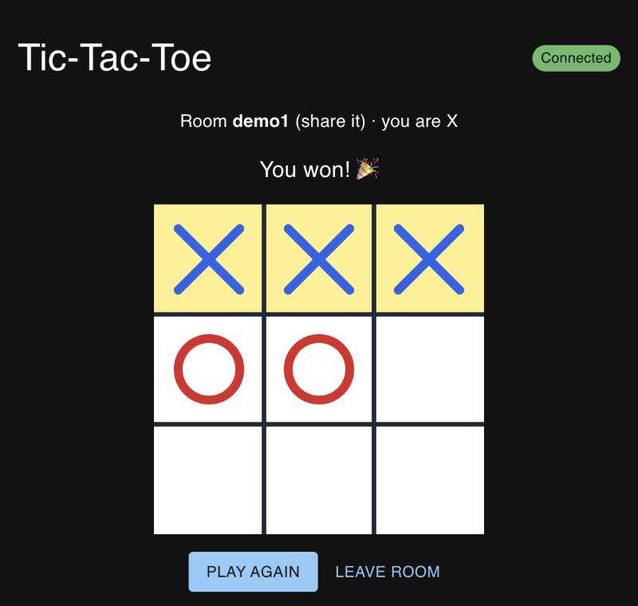
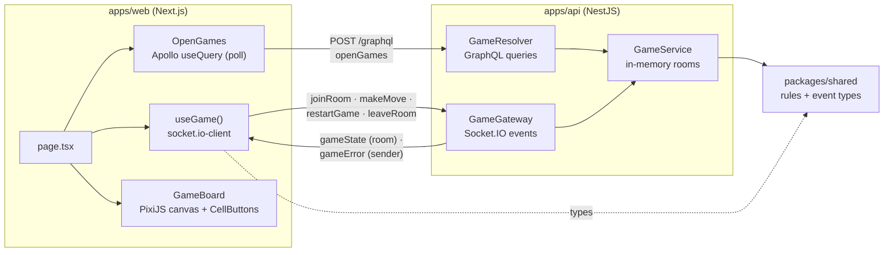
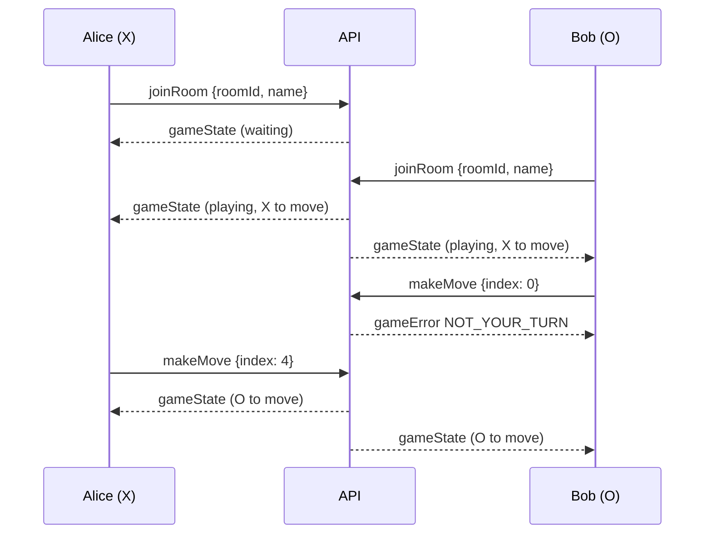

# Realtime Tic-Tac-Toe (Turborepo)

[](https://github.com/eshginfarzali/turborepo_nextjs_nestjs_pixijs/actions/workflows/ci.yml)
[](LICENSE)


Two-player tic-tac-toe in the browser. A NestJS server holds the game state and validates every move. Moves go over Socket.IO, the lobby is a GraphQL query, and a Next.js client draws the board with PixiJS. Both apps import one shared package for the rules and the event types.

<div align="center">
  
</div>

## Features

- **Server-side rules.** The API decides turns, wins and draws. A client cannot play out of turn, take an occupied cell or join a full room. Invalid moves get a `gameError` back, sent only to the player who made them.
- **Rooms.** Join by room id, or leave the field empty to get a new one. The first player is X, the second is O. If a player leaves or disconnects, the other one waits for a new opponent on a fresh board.
- **Lobby over GraphQL.** `openGames` lists rooms that are waiting for a second player. The page refreshes it every 3 s.
- **Live board.** Every move is broadcast to the room. A PixiJS v8 canvas draws the board and highlights the winning line. "Play again" starts a new round.
- **Accessible input.** The canvas only draws. Moves are made through a 3×3 grid of labelled, keyboard-focusable buttons laid over it.
- **One contract.** `@repo/shared` holds the game rules and the typed Socket.IO events. The server and the client compile against the same types.

## Tech stack

| Layer    | Choice                                                                                          |
| -------- | ----------------------------------------------------------------------------------------------- |
| Monorepo | Turborepo 2, pnpm workspaces                                                                    |
| API      | NestJS 12, `@nestjs/graphql` + Apollo Server 5 (code-first), `@nestjs/websockets` + Socket.IO 4 |
| Web      | Next.js 16 (App Router), React 19, PixiJS 8, MUI 9, Apollo Client 4, `socket.io-client`         |
| Shared   | Plain TypeScript: pure game functions and event typings                                         |
| Testing  | Vitest (shared, web), Jest + Supertest + `socket.io-client` (API unit and e2e)                  |
| Tooling  | TypeScript `strict`, ESLint (zero warnings), Prettier, GitHub Actions, Docker Compose           |

## Architecture





```
apps/
  api/            NestJS: game module (gateway, resolver, service), health check, e2e tests
  web/            Next.js: lobby, join form, Pixi board, socket hook
packages/
  shared/         createGame · joinGame · applyMove · leaveGame · restart · event types
turbo.json        task graph: build → lint / typecheck / test / test:e2e
docker-compose.yml
```

### GraphQL schema

```graphql
type Query {
  openGames: [Game!]! # rooms waiting for a second player
  games: [Game!]!
  game(roomId: String!): Game
}

type Game {
  roomId: String!
  board: [String]! # 9 cells, null when empty
  status: String! # waiting | playing | won | draw
  turn: String!
  winner: String
  players: [Player!]!
}
```

The full SDL is generated to [`apps/api/src/schema.gql`](apps/api/src/schema.gql). GraphiQL is served at `http://localhost:3001/graphql`.

## Getting started

### With Docker

```bash
docker compose up --build
```

Open http://localhost:3000 in two browser windows and join the same room. If ports 3000 or 3001 are taken, run `WEB_PORT=3100 API_PORT=3101 docker compose up --build`.

### Locally

Prerequisites: Node.js 22 (see `.nvmrc`) and pnpm (`corepack enable`).

```bash
pnpm install
pnpm dev          # builds @repo/shared, then runs API (:3001) and web (:3000) in watch mode
```

Configuration (all optional; the defaults are shown in the example files):

| File                    | Variable              | Default                 |
| ----------------------- | --------------------- | ----------------------- |
| `apps/api/.env.example` | `PORT`                | `3001`                  |
|                         | `CORS_ORIGIN`         | `http://localhost:3000` |
| `apps/web/.env.example` | `NEXT_PUBLIC_API_URL` | `http://localhost:3001` |

## Scripts

Run from the repo root. Turborepo builds `@repo/shared` first wherever it is needed.

| Script              | What it does                                    |
| ------------------- | ----------------------------------------------- |
| `pnpm dev`          | API + web in watch mode                         |
| `pnpm build`        | Build all packages                              |
| `pnpm lint`         | ESLint, zero warnings allowed                   |
| `pnpm typecheck`    | `tsc --noEmit` in every package                 |
| `pnpm test`         | Unit tests (Vitest and Jest)                    |
| `pnpm test:e2e`     | API end-to-end tests over real sockets and HTTP |
| `pnpm format`       | Prettier write                                  |
| `pnpm format:check` | Prettier check                                  |

## Testing

| Package           | Suite                   | Covers                                                                                                                                                                                                                                     |
| ----------------- | ----------------------- | ------------------------------------------------------------------------------------------------------------------------------------------------------------------------------------------------------------------------------------------ |
| `packages/shared` | `game.test.ts`          | joining and mark assignment, full room, all win lines for X and O, draw, win on the last move, every rejection code, restart, leave                                                                                                        |
| `apps/api`        | `game.service.spec.ts`  | room lifecycle, switching rooms, deleting empty rooms, restart permissions                                                                                                                                                                 |
|                   | `payloads.spec.ts`      | validation of socket payloads (room id format, name length, numeric index)                                                                                                                                                                 |
|                   | `test/game.e2e-spec.ts` | boots the Nest app on a random port: full game over Socket.IO with the win broadcast to both players, out-of-turn move rejected for the sender only, full room, bad payload, disconnect → waiting, GraphQL `openGames` / `game`, `/health` |
| `apps/web`        | `status.test.ts`        | status line from each player's point of view                                                                                                                                                                                               |
|                   | `CellButtons.test.tsx`  | accessible cell labels, clicks, disabled states                                                                                                                                                                                            |
|                   | `JoinForm.test.tsx`     | validation and room id generation                                                                                                                                                                                                          |

CI (`.github/workflows/ci.yml`) runs format → lint → typecheck → unit tests → e2e → build, then builds both Docker images.

## Roadmap

- [ ] Persist rooms and results (Redis or PostgreSQL) so they survive restarts and can be scaled out with the Socket.IO Redis adapter
- [ ] GraphQL subscriptions for the lobby instead of polling
- [ ] Reconnect to the same seat after a page refresh
- [ ] Spectator mode and a match history page
- [ ] Playwright test with two browser contexts

## License

[MIT](LICENSE) © Eshgin Farzaliyev
